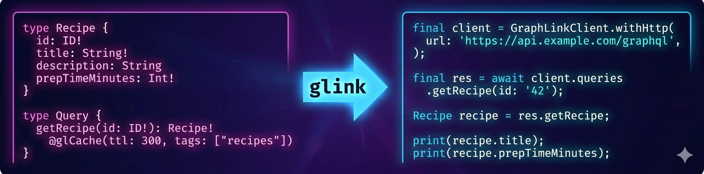

# GraphLink

> GraphQL and REST code generator. Write your schema once and get fully typed clients and servers for Dart/Flutter, Java, TypeScript, Kotlin, Swift, Python, Go, Spring Boot and Express/Apollo — queries, mutations, subscriptions, caching — generated in milliseconds. No boilerplate. No drift.

[](https://pub.dev/packages/graphlink)
[](LICENSE)
[](https://github.com/Oualitsen/graphlink/releases/latest)

---

## What you get

Define a GraphQL schema and GraphLink generates:

- Fully typed query, mutation, and subscription methods — no casting, no generics
- JSON serialization — ready to use, nothing to wire up
- Schema-driven cache control — declare TTL and invalidation in the schema, the generated client handles the rest
- REST operations through the same client — annotate a field with `@glRest` and it is served over HTTP/JSON
- Subscriptions with auto-reconnect, file uploads with progress, persisted queries (APQ) and custom scalar codecs
- Flutter UI input widgets — generated directly from your `input` types
- Zero runtime dependency — delete GraphLink tomorrow, everything still compiles

---

## Installation

### Recommended — `glink` CLI (fastest)

The CLI compiles to a native binary. No Dart VM overhead — regenerates in milliseconds even on large schemas.

```bash
# macOS (ARM)
curl -fsSL https://github.com/Oualitsen/graphlink/releases/latest/download/glink-macos-arm64 -o glink
chmod +x glink && sudo mv glink /usr/local/bin/glink

# macOS (x64)
curl -fsSL https://github.com/Oualitsen/graphlink/releases/latest/download/glink-macos-x64 -o glink
chmod +x glink && sudo mv glink /usr/local/bin/glink

# Linux (x64)
curl -fsSL https://github.com/Oualitsen/graphlink/releases/latest/download/glink-linux-x64 -o glink
chmod +x glink && sudo mv glink /usr/local/bin/glink
```

→ [All releases](https://github.com/Oualitsen/graphlink/releases/latest) — also `glink-linux-arm64`, `glink-windows-x64.exe`

### Alternative — Dart / Flutter package

```bash
flutter pub add --dev graphlink
# or
dart pub add --dev graphlink
```

---

## Quick Start

### 1. Write your schema

```graphql
type Vehicle {
  id: ID!
  brand: String!
  model: String!
  year: Int!
  fuelType: FuelType!
}

enum FuelType { GASOLINE DIESEL ELECTRIC HYBRID }

input AddVehicleInput {
  brand: String!
  model: String!
  year: Int!
  fuelType: FuelType!
}

type Query {
  getVehicle(id: ID!): Vehicle!
  listVehicles: [Vehicle!]!
}

type Mutation {
  addVehicle(input: AddVehicleInput!): Vehicle!
}
```

### 2. Configure

`glink.json` in your project root:

```json
{
  "schemaPaths": ["schema/*.graphql"],
  "mode": "client",
  "typeMappings": { "ID": "String", "Float": "double", "Int": "int", "Boolean": "bool" },
  "outputDir": "lib/generated",
  "clientConfig": {
    "dart": {
      "packageName": "my_app"
    }
  }
}
```

### 3. Generate

```bash
glink              # auto-discovers glink.json / glink.yaml / glink.yml
glink -w           # watch mode — regenerate on every save
```

### 4. Use it

```dart
final client = GraphLinkClient.withHttp(
  url: 'http://localhost:8080/graphql',
  wsUrl: 'ws://localhost:8080/graphql',
  tokenProvider: () async => await getAuthToken(),
);

// Query — fully typed, no casting
final res = await client.queries.getVehicle(id: '42');
print(res.getVehicle.brand);    // Toyota
print(res.getVehicle.fuelType); // FuelType.GASOLINE

// Mutation
await client.mutations.addVehicle(
  input: AddVehicleInput(brand: 'Toyota', model: 'Camry', year: 2023, fuelType: FuelType.GASOLINE),
);

// Subscription
client.subscriptions.vehicleAdded().listen((e) => print(e.vehicleAdded.brand));
```

---

## Schema-driven caching

Cache control lives in your schema — not scattered through your application code. Declare it once, the generated client handles TTL, tag-based invalidation, and offline fallback automatically.

```graphql
type Query {
  # Cache for 2 minutes, tagged "vehicles"
  getVehicle(id: ID!): Vehicle!      @glCache(ttl: "2m", tags: ["vehicles"])

  # Serve stale data when offline instead of throwing
  getUserProfile(id: ID!): UserProfile  @glCache(ttl: "1m", staleIfOffline: true)
}

type Mutation {
  # Automatically evicts all "vehicles" cache entries on success
  addVehicle(input: AddVehicleInput!): Vehicle!  @glCacheInvalidate(tags: ["vehicles"])

  # Wipe everything
  resetData: Boolean!  @glCacheInvalidate(all: true)
}
```

No cache code to write. Cache entries are keyed by operation name + variables — each unique argument combination is cached independently. Bring your own persistent store by implementing `GraphLinkCacheStore`.

---

## Flutter UI widgets

GraphLink generates ready-to-use `InputFormWidget` classes directly from your `input` types. Drop them into any Flutter form — validation, state management, and serialization included.

```dart
AddVehicleInputFormWidget(
  onChanged: (value) => setState(() => _input = value),
)
```

---

## Subscriptions

```dart
client.subscriptions.vehicleAdded().listen((event) {
  print(event.vehicleAdded.brand);
});
```

Reconnection, error handling, and typed payloads are all generated.

---

## Multi-language support

This package is the Dart distribution of GraphLink, but the same schema also generates clients and servers for other languages:

| Target | Language / framework | Status |
|---|---|---|
| Dart client | Dart | Stable |
| Flutter client (UI widget generation) | Dart / Flutter | Stable |
| Java client | Java (blocking, or Reactor / RxJava 3 / Mutiny) | Stable |
| TypeScript client | TypeScript (Angular, React, Vue, Svelte, Node) | Stable |
| Kotlin client | Kotlin (coroutines) | Stable |
| Swift client | Swift (async/await, Apple platforms and Linux) | Stable |
| Python client | Python (pydantic v2, asyncio) | Stable |
| Go client | Go 1.22+ (context-aware, `(value, error)`) | Stable |
| Spring Boot server | Java or Kotlin, MVC or WebFlux | Stable |
| Express / Apollo server | TypeScript (Node.js) | Stable |

Every client generates both **GraphQL** operations and **REST** operations (`@glRest`), caching, subscriptions with auto-reconnect, file uploads, persisted queries and custom scalar codecs. See the [target matrix](https://graphlink.dev/targets.html).

See the [full documentation at graphlink.dev](https://graphlink.dev/) for setup and examples in each language.

---

## REST operations

Serve some fields over plain HTTP/JSON from the same schema and the same generated client:

```graphql
extend type Query @glRestPrefix(path: "/products") {
  product(id: ID!): Product @glRest(path: "/{id}")
}
```

```dart
final product = await client.queries.product(id: 'p1');
```

The call looks like any GraphQL operation. Arguments get explicit roles (`@glRestPath`, `@glRestParam`, `@glRestHeader`, `@glRestBody`, `@glRestField`, `@glRestPart`), responses can be JSON, text, `Void` or a streamed `Download`, and `@glCache` works on REST operations. Available in Dart, Java, TypeScript, Kotlin, Swift, Python and Go. See [REST operations](https://graphlink.dev/rest-client.html) and [why support REST](https://graphlink.dev/why-rest.html): try GraphLink on the API you have, one client-side cache shared with GraphQL, and migrate to GraphQL one field at a time.

---

## What's new in 6.0

- **REST operations in every client.** Annotate a field with `@glRest` and the same generated client calls it over HTTP/JSON. Remove the directive to move the field to GraphQL, and the call site stays the same.
- **Python and Go clients.** pydantic v2 models with an `asyncio` client, and plain structs with a `context`-aware client.
- **Scalar codecs.** A `typeMappings` entry can convert a custom scalar (`DateTime`, `Decimal`, ...) on decode and encode.
- **Validated directives.** Unknown or misspelled directive arguments now fail generation with a line and column. `glink --print-directives` prints the declarations for your IDE.
- **Hardened decoding and streaming uploads** in every client. Some of this is breaking: see the [changelog](https://github.com/Oualitsen/graphlink/blob/main/CHANGELOG.md).

---

## How it compares

| | GraphLink | Typical single-language generator |
|---|---|---|
| Languages from one schema | Dart, Java, TypeScript, Kotlin, Swift, Python, Go | One |
| Server code | Spring Boot, Express / Apollo | Rarely |
| Runtime library in your app | None | Often |
| GraphQL and REST in one client | Yes (`@glRest`) | Usually no |
| Normalized client cache | No (per-operation cache with tags) | Apollo has one |

Choose another tool if you need a normalized client cache or optimistic updates, or if your language is not one of the seven. The full comparison, with the scope of Apollo, GraphQL Code Generator, genqlient, ariadne-codegen and Netflix DGS, is at [graphlink.dev](https://graphlink.dev/philosophy.html#how-it-compares).

---

## Documentation

Full documentation at **[graphlink.dev](https://graphlink.dev/)**

- [Getting Started](https://graphlink.dev/getting-started.html)
- [Supported Targets](https://graphlink.dev/targets.html)
- Clients: [Dart / Flutter](https://graphlink.dev/dart-client.html), [Java](https://graphlink.dev/java-client.html), [TypeScript](https://graphlink.dev/typescript-client.html), [Kotlin](https://graphlink.dev/kotlin-client.html), [Swift](https://graphlink.dev/swift-client.html), [Python](https://graphlink.dev/python-client.html), [Go](https://graphlink.dev/go-client.html)
- Servers: [Spring Boot](https://graphlink.dev/spring-server.html), [Express / Apollo](https://graphlink.dev/express-apollo.html)
- [Why Support REST](https://graphlink.dev/why-rest.html)
- [REST Operations](https://graphlink.dev/rest-client.html)
- [Custom Queries & Mutations](https://graphlink.dev/custom-queries.html)
- [Caching](https://graphlink.dev/caching.html)
- [Persisted Queries](https://graphlink.dev/persisted-queries.html)
- [Directives Reference](https://graphlink.dev/directives.html)
- [Configuration Reference](https://graphlink.dev/configuration.html)
- [For AI agents](https://graphlink.dev/ai-agents.html) and [llms.txt](https://graphlink.dev/llms.txt)

---

## License

MIT — see [LICENSE](LICENSE).

Issues and contributions welcome at [github.com/Oualitsen/graphlink](https://github.com/Oualitsen/graphlink).
