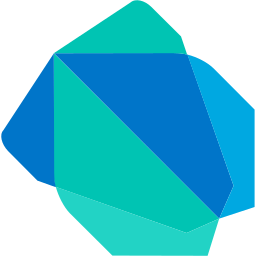
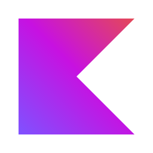
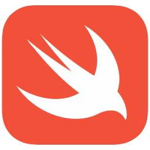
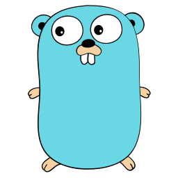

# GraphLink

<div class="gl-hero" markdown>

## You already wrote the schema.
### Why are you writing the interface again? And the class?

GraphLink is the only generator that treats your `.graphql` file as the *actual* source of truth — not documentation you also hand-copy into two more languages, every time it changes, forever.

</div>

<div class="gl-carousel" markdown>

<div class="gl-tabs" role="tablist">
<button class="gl-tab" role="tab" aria-label="Dart / Flutter" title="Dart / Flutter"></button>
<button class="gl-tab" role="tab" aria-label="Java" title="Java"></button>
<button class="gl-tab" role="tab" aria-label="Kotlin" title="Kotlin"></button>
<button class="gl-tab" role="tab" aria-label="TypeScript" title="TypeScript"></button>
<button class="gl-tab" role="tab" aria-label="Swift" title="Swift"></button>
<button class="gl-tab" role="tab" aria-label="Python" title="Python"></button>
<button class="gl-tab" role="tab" aria-label="Go" title="Go"></button>
</div>

<div class="gl-slides" markdown>

<div class="gl-slide" markdown>

<div class="gl-slide-head" markdown>
<div class="gl-slide-name">Dart / Flutter</div>
<div class="gl-pills"><span class="gl-pill">GraphQL</span><span class="gl-pill">REST</span></div>
</div>

<div class="gl-slide-code" markdown>

```dart
// 1. Create the client
final graphlinkClient = GraphLinkClient.withHttp(
  url: 'http://localhost:8080/graphql',
  wsUrl: 'ws://localhost:8080/graphql',
  tokenProvider: () async => await getAuthToken(), // optional
);

// 2. Call a query: typed arguments in, typed object out
final res = await graphlinkClient.queries.getVehicle(id: 'v-1');
print('${res.getVehicle.brand} ${res.getVehicle.model}');
```

</div>

</div>

<div class="gl-slide" markdown>

<div class="gl-slide-head" markdown>
<div class="gl-slide-name">Java</div>
<div class="gl-pills"><span class="gl-pill">GraphQL</span><span class="gl-pill">REST</span></div>
</div>

<div class="gl-slide-code" markdown>

```java
// 1. Create the client
var graphlinkClient = new GraphLinkClient("http://localhost:8080/graphql");

// 2. Call a query: no generics, no casting
var vehicle = graphlinkClient.queries.getVehicle("v-1").getVehicle();
System.out.println(vehicle.getBrand() + " " + vehicle.getModel());
```

</div>

</div>

<div class="gl-slide" markdown>

<div class="gl-slide-head" markdown>
<div class="gl-slide-name">Kotlin</div>
<div class="gl-pills"><span class="gl-pill">GraphQL</span><span class="gl-pill">REST</span></div>
</div>

<div class="gl-slide-code" markdown>

```kotlin
// 1. Create the client
val graphlinkClient = GraphLinkClient.create("http://localhost:8080/graphql")

// 2. Call a query from a coroutine
val vehicle = runBlocking { graphlinkClient.queries.getVehicle("v-1").getVehicle }
println("${vehicle.brand} ${vehicle.model}")
```

</div>

</div>

<div class="gl-slide" markdown>

<div class="gl-slide-head" markdown>
<div class="gl-slide-name">TypeScript</div>
<div class="gl-pills"><span class="gl-pill">GraphQL</span><span class="gl-pill">REST</span></div>
</div>

<div class="gl-slide-code" markdown>

```typescript
// 1. Create the client
const adapter = new GraphLinkFetchAdapter('http://localhost:8080/graphql');
const graphlinkClient = new GraphLinkClient(adapter.call.bind(adapter));

// 2. Call a query: fully typed, no "as" casts
const res = await graphlinkClient.queries.getVehicle('v-1');
console.log(`${res.getVehicle.brand} ${res.getVehicle.model}`);
```

</div>

</div>

<div class="gl-slide" markdown>

<div class="gl-slide-head" markdown>
<div class="gl-slide-name">Swift</div>
<div class="gl-pills"><span class="gl-pill">GraphQL</span><span class="gl-pill">REST</span></div>
</div>

<div class="gl-slide-code" markdown>

```swift
// 1. Create the client (wsUrl is needed only for subscriptions)
let graphlinkClient = GraphLinkClient.create(
    url: URL(string: "http://localhost:8080/graphql")!,
    wsUrl: URL(string: "ws://localhost:8080/graphql")!
)

// 2. Call a query with async/await
let vehicle = try await graphlinkClient.queries.getVehicle(id: "v-1").getVehicle
print("\(vehicle.brand) \(vehicle.model)")
```

</div>

</div>

<div class="gl-slide" markdown>

<div class="gl-slide-head" markdown>
<div class="gl-slide-name">Python</div>
<div class="gl-pills"><span class="gl-pill">GraphQL</span><span class="gl-pill">REST</span></div>
</div>

<div class="gl-slide-code" markdown>

```python
# 1. Create the client
graphlink_client = GraphLinkClient.with_http(
    url="http://localhost:8080/graphql",
    ws_url="ws://localhost:8080/graphql",
)

# 2. Call a query: keyword-only arguments, pydantic models out
res = await graphlink_client.queries.get_vehicle(id="v-1")
print(res.get_vehicle.brand, res.get_vehicle.model)
```

</div>

</div>

<div class="gl-slide" markdown>

<div class="gl-slide-head" markdown>
<div class="gl-slide-name">Go</div>
<div class="gl-pills"><span class="gl-pill">GraphQL</span><span class="gl-pill">REST</span></div>
</div>

<div class="gl-slide-code" markdown>

```go
// 1. Create the client
graphlinkClient, err := graphql.NewGraphLinkClientWithHttp(graphql.GraphLinkHttpOptions{
    URL:   "http://localhost:8080/graphql",
    WsURL: "ws://localhost:8080/graphql",
})
if err != nil {
    return err
}

// 2. Call a query: (value, error), context-aware
res, err := graphlinkClient.Queries.GetVehicle(ctx, "v-1")
if err != nil {
    return err
}
fmt.Println(res.GetVehicle.Brand, res.GetVehicle.Model)
```

</div>

</div>

</div>

<ol class="gl-steps">
<li>Write your <code>.graphql</code> schema</li>
<li>Run <code>glink</code></li>
<li>Create the client and call it, as above</li>
</ol>

<p class="gl-carousel-caption">One schema, one generated client. A field is served over GraphQL or REST (<code>@glRest</code>) and the call site stays the same. <a href="why-rest.html">Why support REST?</a></p>

</div>

> Your `.graphql` schema compiles to a fully typed client and server — for Dart, Flutter, Java, TypeScript, Kotlin, Swift, Python, Go, Spring Boot, and Express/Apollo — in milliseconds.

[](https://pub.dev/packages/graphlink)
[](https://github.com/Oualitsen/graphlink/blob/main/LICENSE)
[](https://github.com/Oualitsen/graphlink/releases/latest)

**No runtime. No boilerplate. No schema drift.**

---

<div class="gl-pain-list" markdown>

### What stops being your problem

1. **Your database falling over from N+1 queries.** A clean-looking resolver fires 500 tiny queries for one list view — invisible in dev, discovered in production. Declare `@glSkipOnServer(batch: true)`{: .gl-good-inline } once; GraphLink generates the `DataLoader`{: .gl-good-inline } / `@BatchMapping`{: .gl-good-inline } for you.
2. **Three hand-maintained copies of every type.** Schema, frontend interface, backend class — same shape, written by hand, three times, drifting apart within a sprint. One schema, every typed target, regenerated in milliseconds.
3. **Untyped response casting.** `TypeReference<GraphQLResponse<Map<String,Object>>>`{: .gl-bad-inline } and its friends. GraphLink returns fully-resolved typed objects on every target — no casting, no generics, no guessing at the shape.
4. **Auth checks copy-pasted into every resolver** — and forgotten on the one you added last week. `@glIntercept`{: .gl-good-inline } runs one generated hook before any annotated field executes, so there's nothing to forget.
5. **Cache logic that requires a PhD to operate.** Apollo Client: `typePolicies`{: .gl-bad-inline } per type, hand-written `merge`{: .gl-bad-inline } functions for pagination, and `cache.evict`{: .gl-bad-inline }/`cache.modify`{: .gl-bad-inline } calls keyed to the *exact* normalized field-and-args cache identifier — get one character wrong and stale data just sits there, silently, forever. We ran the numbers, peer-reviewed and everything:

    **The Apollo way**{: .gl-cache-bad-label }

    ```text { .gl-cache-bad }
    cacheKey ≜ ROOT_QUERY.field( ∮ Σᵢ₌₀ⁿ argsᵢ · e^(iπ·keyArgs) dΩ )
             ⊕ ∬∬ merge(existing, incoming, {args, isReference, readField, storeFieldName}) d(typePolicies)²
             − ∂³(sanity) / ∂cache.modify ∂cache.evict ∂mergeFunction
             + lim_{x→∞} StackOverflow(x)
             ≈ NaN   (converges to "it depends", p < 0.05, campfire required)
    ```

    Checks out. Nobody on the team understands it. Apollo's a genuinely great library — this part just needs a PhD.

    ---

    **The GraphLink way**{: .gl-cache-good-label }

    ```graphql { .gl-cache-good }
    type Query {
      # cached for 5 minutes, tagged "vehicles" — nothing to configure client-side
      getVehicle(id: ID!): Vehicle! @glCache(ttl: "5m", tags: ["vehicles"])
    }

    type Mutation {
      # on success, every "vehicles"-tagged cache entry is evicted automatically
      addVehicle(input: AddVehicleInput!): Vehicle! @glCacheInvalidate(tags: ["vehicles"])
    }
    ```

6. **Getting locked into a runtime.** Generated code has zero dependency on GraphLink. Stop using it tomorrow and everything still compiles.

</div>

---

## One schema. Every client. Every language.

Write your API once in GraphQL. Run `glink`. Every target regenerates in milliseconds.

```
schema/*.graphql
  │
  ├── lib/generated/                        Flutter / Dart client
  ├── src/main/java/com/app/generated/      Java client
  ├── src/generated/                        TypeScript client
  ├── src/main/kotlin/com/app/generated/    Kotlin client
  └── src/main/java/com/app/generated/      Spring Boot server
```

Add a field to the schema — run `glink` — it appears in every client, every language, immediately typed. No hand-written DTOs. No copy-pasted response classes. No drift between frontend and backend.

=== "Dart / Flutter"

    ```dart
    final res = await client.queries.getVehicle(id: "v-1");
    print("${res.getVehicle.brand} ${res.getVehicle.model}");
    ```

=== "Java"

    ```java
    Vehicle v = client.queries.getVehicle("v-1").getVehicle();
    System.out.println(v.getBrand() + " " + v.getModel());
    ```

=== "TypeScript"

    ```typescript
    const res = await client.queries.getVehicle("v-1");
    console.log(`${res.getVehicle.brand} ${res.getVehicle.model}`);
    ```

=== "Kotlin"

    ```kotlin
    val v = client.queries.getVehicle("v-1").getVehicle
    println("${v.brand} ${v.model}")
    ```

The call site is clean in every language. One schema. Zero boilerplate.

---

## Already have a REST API?

You do not need a GraphQL server to start. Annotate a field with `@glRest` and the same generated client calls your REST API, in all seven languages.

<div class="grid cards" markdown>

- **[Taste it today](why-rest.md#1-taste-graphlink-on-the-api-you-already-have)** — A typed client for the API you have, from a few lines of schema.
- **[A real client-side cache](why-rest.md#2-a-real-cache-on-the-frontend-not-an-http-cache)** — `@glCache` with tags, shared with GraphQL, not tied to HTTP headers.
- **[Migrate one field at a time](why-rest.md#3-a-way-to-migrate-one-field-at-a-time)** — Remove the directive and the call site does not change.

</div>

[Why support REST?](why-rest.md){ .md-button .md-button--primary } [Read the article](blog/posts/rest-first-graphql-later.md){ .md-button }

---

## Before GraphLink, After GraphLink

<!-- AUTHOR STORY: personal origin story goes here — replace/extend this intro paragraph -->

Every GraphQL client library sells you the same promise: write a schema, get a client. What they don't show you is what "client" actually meant before code generation caught up to that promise — the hand-written DTO, the casts, the generics, kept in sync with the server by hand, in every language you ship.

=== "Java"

    <div class="ba-grid grid" markdown>

    <div class="ba-card ba-without" markdown>

    **Without GraphLink**

    ```java
    GraphQLResponse<Map<String, Object>> response =
        client.query(new SimpleGraphQLRequest<>(
            "query getVehicle($id: ID!) { getVehicle(id: $id) { id brand year } }",
            Map.of("id", "42"),
            new TypeReference<GraphQLResponse<Map<String, Object>>>() {}
        ));
    @SuppressWarnings("unchecked")
    Map<String, Object> vehicleMap =
        (Map<String, Object>) response.getData().get("getVehicle");
    String brand = (String) vehicleMap.get("brand");
    Integer year = ((Number) vehicleMap.get("year")).intValue();
    ```

    </div>

    <div class="ba-card ba-with" markdown>

    **With GraphLink**

    ```java
    Vehicle v = client.queries.getVehicle("42").getVehicle();
    System.out.println(v.getBrand() + " " + v.getYear());
    ```

    </div>

    </div>

=== "Dart"

    <div class="ba-grid grid" markdown>

    <div class="ba-card ba-without" markdown>

    **Without GraphLink**

    ```dart
    final response = await http.post(uri, body: jsonEncode({
      'query': query,
      'variables': {'id': id},
    }));
    final json = jsonDecode(response.body) as Map<String, dynamic>;
    final vehicle = json['data']['getVehicle'] as Map<String, dynamic>;
    final brand = vehicle['brand'] as String;
    final year = vehicle['year'] as int;
    // Hope nobody renamed a field on the server last sprint.
    ```

    </div>

    <div class="ba-card ba-with" markdown>

    **With GraphLink**

    ```dart
    final res = await client.queries.getVehicle(id: '42');
    print('${res.getVehicle.brand} ${res.getVehicle.year}');
    ```

    </div>

    </div>

=== "Kotlin"

    <div class="ba-grid grid" markdown>

    <div class="ba-card ba-without" markdown>

    **Without GraphLink**

    ```kotlin
    val response = httpClient.post(url) { setBody(payload) }
    val json = Json.parseToJsonElement(response.bodyAsText()).jsonObject
    val vehicleJson = json["data"]!!.jsonObject["getVehicle"]!!.jsonObject
    val vehicle = Vehicle(
        id = vehicleJson["id"]!!.jsonPrimitive.content,
        brand = vehicleJson["brand"]!!.jsonPrimitive.content,
        year = vehicleJson["year"]!!.jsonPrimitive.int
    )
    // Hand-written data class, hand-written parsing, kept in sync by hand.
    ```

    </div>

    <div class="ba-card ba-with" markdown>

    **With GraphLink**

    ```kotlin
    val v = client.queries.getVehicle("42").getVehicle
    println("${v.brand} ${v.year}")
    ```

    </div>

    </div>

=== "TypeScript"

    <div class="ba-grid grid" markdown>

    <div class="ba-card ba-without" markdown>

    **Without GraphLink**

    ```typescript
    interface Vehicle { id: string; brand: string; year: number; } // hand-written, drifts from schema

    const res = await fetch(url, { method: 'POST', body: JSON.stringify({ query, variables: { id } }) });
    const json = await res.json();
    const vehicle = json.data.getVehicle as Vehicle; // "as" — TS trusts you, the server doesn't have to
    console.log(vehicle.brand, vehicle.year);
    ```

    </div>

    <div class="ba-card ba-with" markdown>

    **With GraphLink**

    ```typescript
    const res = await client.queries.getVehicle("42");
    console.log(res.getVehicle.brand, res.getVehicle.year);
    ```

    </div>

    </div>

<div id="ba-payoff" class="ba-payoff"></div>

It's not only the typed fetch. The same gap shows up in **subscriptions** (hand-rolled reconnect/backoff vs. an adapter that reconnects forever, out of the box) and in **caching** (a bespoke TTL/tag cache re-implemented per language vs. `@glCache(ttl: "2m", tags: ["vehicles"])` declared once in the schema). Multiply all of it by every query, every mutation, every language your stack touches, and the real cost of "no codegen" shows up: hundreds of hand-written DTOs and a schema that quietly drifts from the code that's supposed to implement it.

---

## Why GraphLink?

### 1. Cache control lives in the schema

Annotate any query or mutation directly in your `.graphql` file. The generated client handles TTL, tag-based invalidation, partial query caching, and offline fallback automatically — across every target language.

```graphql
type Query {
  getVehicle(id: ID!): Vehicle! @glCache(ttl: "2m", tags: ["vehicles"])
  listVehicles: [Vehicle!]!     @glCache(ttl: "1m", tags: ["vehicles"])
}

type Mutation {
  addVehicle(input: AddVehicleInput!): Vehicle! @glCacheInvalidate(tags: ["vehicles"])
}
```

The second call is served from cache. `addVehicle` evicts the `"vehicles"` tag automatically. No cache layer to wire up. No manual invalidation logic. The schema says it; the generated client does it.

---

### 2. Subscriptions — with auto-reconnect out of the box

This is where most GraphQL client libraries fall short: they generate a WebSocket subscription method but leave reconnection entirely to you. Network drops, server restarts, idle timeouts — your app silently stops receiving events.

GraphLink generates a default WebSocket adapter for every target — **with auto-reconnect enabled by default**. The connection drops, it comes back, your `Flow` / `Stream` / `Observable` keeps emitting. No reconnection logic to write. No silent failures.

=== "Kotlin"

    ```kotlin
    scope.launch {
        client.subscriptions.userCreated().collect { event ->
            println("New user: ${event.userCreated.name}")
        }
    }
    ```

=== "Dart"

    ```dart
    client.subscriptions.onUserCreated().listen((event) {
      print("New user: ${event.userCreated.name}");
    });
    ```

=== "TypeScript"

    ```typescript
    client.subscriptions.userCreated().subscribe(event => {
      console.log("New user:", event.userCreated.name);
    });
    ```

The generated adapter speaks the [graphql-ws](https://github.com/enisdenjo/graphql-ws) protocol and handles the full connection lifecycle — `connection_init`, `connection_ack`, `subscribe`, `ping/pong`, and reconnect — all covered by integration tests.

---

### 3. The server is generated too

GraphLink isn't only a client generator. Switch to `mode: server` and point it at your Spring Boot project. It generates controllers, service interfaces, input classes, and DTOs — wired up to the schema, ready to implement.

```
schema/*.graphql  →  @SchemaMapping controllers
                     Service interfaces to implement
                     Input classes with null-safety
                     Type DTOs
```

You implement the business logic. GraphLink handles the plumbing.

---

### 4. Generated code you own completely

The output is ordinary Dart, Java, TypeScript, Kotlin, Swift, Python, or Go — no runtime dependency on GraphLink whatsoever. Stop using it tomorrow and everything keeps compiling. Commit the output to your repo, vendor it, ship it. It's just code.

---

## In production

Measured in [Optidialysis](https://www.optidialysis.com/) — a multi-tenant dialysis clinic management platform.

**72% of the Spring Boot backend — generated.** Controllers, service interfaces, DTOs, input classes, enums — all from one `.graphql` file. Only **135 files (~11.8k lines)** written by hand across the entire backend.

| What | Generated |
|---|---|
| Spring Boot files | **72%** |
| Spring Boot lines | **64%** |
| Flutter codebase | **21.5%** |

Every generated file compiles, ships, and runs with zero runtime dependency on GraphLink.

---

## Supported targets

### Clients

Seven languages, each with a typed GraphQL client and generated [REST operations](rest-client.md) from the same schema.

<div class="gl-targets" markdown>

<div class="gl-target" markdown>
<div class="gl-target-icons" markdown></div>
<div class="gl-target-name">Dart / Flutter</div>
<div class="gl-target-sub">http or Dio</div>
<div class="gl-pills"><span class="gl-pill">GraphQL</span><span class="gl-pill">REST</span></div>
</div>

<div class="gl-target" markdown>
<div class="gl-target-icons" markdown></div>
<div class="gl-target-name">Java</div>
<div class="gl-target-sub">blocking or reactive</div>
<div class="gl-pills"><span class="gl-pill">GraphQL</span><span class="gl-pill">REST</span></div>
</div>

<div class="gl-target" markdown>
<div class="gl-target-icons" markdown></div>
<div class="gl-target-name">Kotlin</div>
<div class="gl-target-sub">coroutines, OkHttp</div>
<div class="gl-pills"><span class="gl-pill">GraphQL</span><span class="gl-pill">REST</span></div>
</div>

<div class="gl-target" markdown>
<div class="gl-target-icons" markdown></div>
<div class="gl-target-name">TypeScript</div>
<div class="gl-target-sub">fetch or axios</div>
<div class="gl-pills"><span class="gl-pill">GraphQL</span><span class="gl-pill">REST</span></div>
</div>

<div class="gl-target" markdown>
<div class="gl-target-icons" markdown></div>
<div class="gl-target-name">Swift</div>
<div class="gl-target-sub">async/await, URLSession</div>
<div class="gl-pills"><span class="gl-pill">GraphQL</span><span class="gl-pill">REST</span></div>
</div>

<div class="gl-target" markdown>
<div class="gl-target-icons" markdown></div>
<div class="gl-target-name">Python</div>
<div class="gl-target-sub">asyncio, httpx</div>
<div class="gl-pills"><span class="gl-pill">GraphQL</span><span class="gl-pill">REST</span></div>
</div>

<div class="gl-target" markdown>
<div class="gl-target-icons" markdown></div>
<div class="gl-target-name">Go</div>
<div class="gl-target-sub">context-aware, net/http</div>
<div class="gl-pills"><span class="gl-pill">GraphQL</span><span class="gl-pill">REST</span></div>
</div>

</div>

### Servers

<div class="gl-targets" markdown>

<div class="gl-target" markdown>
<div class="gl-target-icons" markdown></div>
<div class="gl-target-name">Spring Boot</div>
<div class="gl-target-sub">Java or Kotlin, MVC or WebFlux</div>
<div class="gl-pills"><span class="gl-pill">GraphQL</span></div>
</div>

<div class="gl-target" markdown>
<div class="gl-target-icons" markdown></div>
<div class="gl-target-name">Express / Apollo</div>
<div class="gl-target-sub">TypeScript, DataLoader</div>
<div class="gl-pills"><span class="gl-pill">GraphQL</span></div>
</div>

</div>

---

## Installation

Download the single self-contained binary — no JVM, no package manager required.

=== "macOS (ARM)"

    ```bash
    curl -fsSL https://github.com/Oualitsen/graphlink/releases/latest/download/glink-macos-arm64 -o glink
    chmod +x glink && sudo mv glink /usr/local/bin/glink
    ```

=== "macOS (x64)"

    ```bash
    curl -fsSL https://github.com/Oualitsen/graphlink/releases/latest/download/glink-macos-x64 -o glink
    chmod +x glink && sudo mv glink /usr/local/bin/glink
    ```

=== "Linux (x64)"

    ```bash
    curl -fsSL https://github.com/Oualitsen/graphlink/releases/latest/download/glink-linux-x64 -o glink
    chmod +x glink && sudo mv glink /usr/local/bin/glink
    ```

=== "Windows"

    Download [`glink-windows-x64.exe`](https://github.com/Oualitsen/graphlink/releases/latest) and add it to your PATH.

=== "Dart / Flutter (pub)"

    ```bash
    flutter pub add --dev graphlink
    # or
    dart pub add --dev graphlink
    ```

=== "Docker"

    ```bash
    docker run --rm -v "$PWD":/workspace -w /workspace \
      oualitsen/graphlink:latest -c glink.json
    ```

    Multi-arch (`amd64`/`arm64`) image: [`oualitsen/graphlink`](https://hub.docker.com/r/oualitsen/graphlink). No JVM, no local binary — good fit for CI.

---

## Quick Start

### 1. Write your schema

```graphql
type Vehicle {
  id: ID!
  brand: String!
  model: String!
  year: Int!
  fuelType: FuelType!
}

enum FuelType { GASOLINE DIESEL ELECTRIC HYBRID }

input AddVehicleInput {
  brand: String!
  model: String!
  year: Int!
  fuelType: FuelType!
}

type Query {
  getVehicle(id: ID!): Vehicle!  @glCache(ttl: "2m", tags: ["vehicles"])
  listVehicles: [Vehicle!]!      @glCache(ttl: "1m", tags: ["vehicles"])
}

type Mutation {
  addVehicle(input: AddVehicleInput!): Vehicle! @glCacheInvalidate(tags: ["vehicles"])
}
```

### 2. Configure

Pick your target and drop a `glink.yaml` next to your schema:

=== "Dart / Flutter"

    ```yaml
    schemaPaths:
      - lib/**/*.graphql
    mode: client
    typeMappings:
      ID: String
      Float: double
      Int: int
      Boolean: bool
    outputDir: lib/generated
    clientConfig:
      dart:
        packageName: my_app
    ```

=== "Java"

    ```yaml
    schemaPaths:
      - schema/*.graphql
    mode: client
    typeMappings:
      ID: String
      Float: Double
      Int: Integer
      Boolean: Boolean
    outputDir: src/main/java/com/example/generated
    clientConfig:
      java:
        packageName: com.example.generated
    ```

=== "TypeScript"

    ```yaml
    schemaPaths:
      - schema/*.graphql
    mode: client
    typeMappings:
      ID: string
      Float: number
      Int: number
      Boolean: boolean
    outputDir: src/generated
    clientConfig:
      typescript:
        httpAdapter: fetch
    ```

=== "Kotlin"

    ```yaml
    schemaPaths:
      - schema/*.graphql
    mode: client
    typeMappings:
      ID: String
      Float: Double
      Int: Int
      Boolean: Boolean
    outputDir: src/main/kotlin/com/example/generated
    clientConfig:
      kotlin:
        packageName: com.example.generated
    ```

=== "Spring Boot"

    ```yaml
    schemaPaths:
      - src/main/resources/graphql/*.graphqls
    mode: server
    typeMappings:
      ID: String
      Float: Double
      Int: Integer
      Boolean: Boolean
    outputDir: src/main/java/com/example/generated
    serverConfig:
      spring:
        basePackage: com.example.generated
    ```

=== "Express / Apollo"

    ```yaml
    schemaPaths:
      - schema/*.graphql
    mode: server
    typeMappings:
      ID: string
      Float: number
      Int: number
      Boolean: boolean
    outputDir: src/generated
    serverConfig:
      expressApollo:
        port: 4000
        graphqlPath: /graphql
    ```

### 3. Generate

```bash
glink       # auto-discovers glink.yaml / glink.json / glink.yml
glink -w    # watch mode — regenerate on every save
```

→ See [Getting Started](getting-started.md) for a complete walkthrough per language.

---

## FAQ

??? "Does the generated code have a runtime dependency on GraphLink?"

    None. If you stop using GraphLink tomorrow, every generated file continues to compile
    and work exactly as before. The output is ordinary Dart, Java, TypeScript, Kotlin, Swift,
    Python, or Go — you own it completely.

??? "Which languages and frameworks does GraphLink support?"

    Clients for Dart and Flutter, Java (blocking or reactive), TypeScript (Angular, React, Vue,
    Svelte, Node), Kotlin (coroutines), Swift (async/await), Python (pydantic and asyncio) and Go
    (context-aware, `(value, error)`). Servers for Spring Boot in Java or Kotlin (MVC and WebFlux)
    and Express/Apollo in TypeScript. See [Supported Targets](targets.md) for the full matrix.

??? "Can the generated client call REST APIs?"

    Yes. Annotate a field of `Query` or `Mutation` with `@glRest` and the client calls it over
    HTTP/JSON, with the same call syntax as a GraphQL operation, in all seven clients. Removing the
    directive moves the field to GraphQL without changing the call site. See
    [REST Operations](rest-client.md).

??? "How does GraphLink compare with Apollo, GraphQL Code Generator and other generators?"

    Most generators cover one language or framework. GraphLink generates both the classes and the
    typed client operations for seven languages, plus Spring Boot and Express/Apollo servers, from
    one schema with no runtime library. Choose another tool if you need a normalized client cache
    or optimistic updates, or if your language is not one of the seven. See
    [How it compares](philosophy.md#how-it-compares).

??? "Does the generated server handle concurrency and the N+1 problem?"

    Generated handlers are asynchronous by default (`CompletableFuture` on Java MVC, `Mono` on
    reactive, `suspend` on Kotlin, `async` on Express), so sibling query fields can run
    concurrently. `@glSkipOnServer(batch: true)` generates a `@BatchMapping` or a DataLoader to fix
    N+1. See [Concurrent execution](spring-server.md#concurrent-execution).

??? "What happens when I add a field to the schema?"

    Run `glink` (or let `glink -w` pick it up automatically). All affected files are
    regenerated and the new field is immediately available as a typed property in every
    target. One file to edit — GraphLink handles the rest.

??? "How does the built-in caching work?"

    Cache behaviour is declared in the schema using two directives.
    `@glCache(ttl: "5m", tags: ["cars"])` caches a query result for 5 minutes under the
    tag `"cars"`. `@glCacheInvalidate(tags: ["cars"])` on a mutation evicts all entries
    tagged `"cars"` when the mutation succeeds. Individual fields inside a compound query
    can each carry their own TTL — if one tag is invalidated, the others stay warm.
    See [Caching](caching.md) for the full reference.

??? "Is GraphLink production-ready?"

    Yes. In one production deployment (multi-tenant SaaS, dialysis clinic management),
    72% of Spring Boot files and 64% of lines are generated — only 135 files written by
    hand across the entire backend. On the Flutter side, 21.5% of the codebase is
    generated, covering all DTOs, input classes, enums, and GraphQL client wiring.

??? "Can I use GraphLink with an existing project?"

    Yes. Point `schemaPaths` at your existing `.graphql` files and set `outputDir` to
    wherever you want the generated files. GraphLink does not touch any of your existing
    source files.

??? "Does it work for full-stack monorepos?"

    Yes — this is the primary use case. Run `glink` with different config files (or different
    `outputDir` values) to generate the Flutter client, the Java client, and the Spring Boot
    server from the same schema. One schema, multiple configs, all in sync.

---

## Documentation

<div class="grid cards" markdown>

- **[Philosophy](philosophy.md)** — Why pure code generation? Why no runtime abstractions?
- **[Getting Started](getting-started.md)** — Zero to generated code in 5 minutes.
- **[Supported Targets](targets.md)** — Every language and the features each supports.
- **[Dart / Flutter Client](dart-client.md)** — Typed queries, mutations, subscriptions. Adapter pattern.
- **[Java Client](java-client.md)** — No generics. No casting. Builder pattern on all inputs.
- **[TypeScript Client](typescript-client.md)** — Typed client for Angular, React, Vue, and Node.
- **[Kotlin Client](kotlin-client.md)** — Coroutine-based client with data classes and kotlinx.serialization.
- **[Swift Client](swift-client.md)** — async/await client with Sendable structs, no third-party dependency.
- **[Python Client](python-client.md)** — pydantic v2 models and an asyncio client.
- **[Go Client](go-client.md)** — plain structs and a context-aware client returning `(value, error)`.
- **[Spring Boot](spring-server.md)** — Generated controllers, service interfaces, types, inputs.
- **[Express / Apollo](express-apollo.md)** — Generated resolvers, service interfaces, DataLoader batch mappings.
- **[Custom Queries & Mutations](custom-queries.md)** — Hand-written operations next to the schema, typed end to end.
- **[Why Support REST](why-rest.md)** — Try GraphLink on your REST API, cache it, and migrate to GraphQL one field at a time.
- **[REST Operations](rest-client.md)** — Serve fields over HTTP/JSON from the same schema and client.
- **[Persisted Queries](persisted-queries.md)** — APQ in every generated client.
- **[Caching](caching.md)** — `@glCache` and `@glCacheInvalidate`. Tag-based invalidation.
- **[Skip directives](skip-directives.md)** — `@glSkipOnServer` and `@glSkipOnClient`.
- **[Directives](directives.md)** — Complete reference for all GraphLink directives.
- **[Configuration](configuration.md)** — Every `glink.json` / `glink.yaml` option explained.
- **[AI Agents](ai-agents.md)** — Ready-to-copy instructions for Claude Code, Gemini CLI, and others.

</div>

---

**GraphLink** — MIT License — [graphlink.dev](https://graphlink.dev)

| | |
|---|---|
| **Source** | [github.com/Oualitsen/graphlink](https://github.com/Oualitsen/graphlink) |
| **Package** | [pub.dev/packages/graphlink](https://pub.dev/packages/graphlink) |
| **Releases** | [github.com/Oualitsen/graphlink/releases](https://github.com/Oualitsen/graphlink/releases) |
| **Changelog** | [CHANGELOG.md](https://github.com/Oualitsen/graphlink/blob/main/CHANGELOG.md) |
| **Bug reports** | [github.com/Oualitsen/graphlink/issues](https://github.com/Oualitsen/graphlink/issues) |
| **Discussions** | [github.com/Oualitsen/graphlink/discussions](https://github.com/Oualitsen/graphlink/discussions) |
| **Author** | [github.com/Oualitsen](https://github.com/Oualitsen) |
